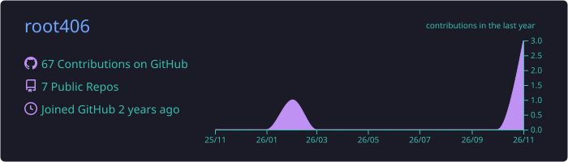
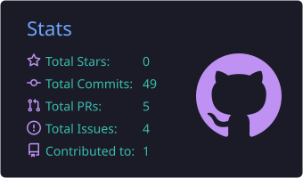
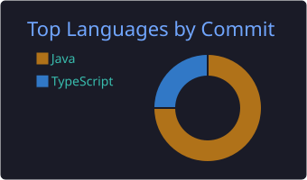
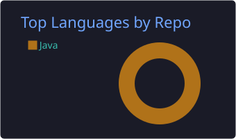
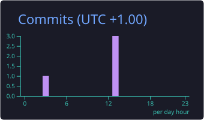

<h1 align="center">Hi 👋, I'm root406</h1>

  

  
  
  

---

### 🔥 GitHub Stats

  

  
  

  
  

  

  

---

### 🚀 Featured Project

  
   
  
  
  

---

<i>"Code is like humor. When you have to explain it, it's bad." – Cory House</i>

